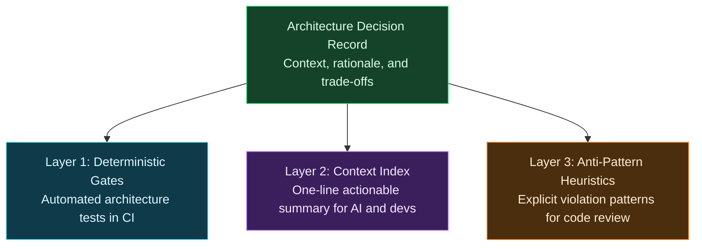

# Enforcing ADRs with Deterministic Architecture Tests

**TL;DR:** Architecture Decision Records (ADRs) turn into dead documentation the moment a team accumulates more than thirty decisions. I stop this architectural drift by enforcing rules deterministically: automated architecture tests fail the build on broken boundaries, a one-line context index keeps rules inside human and AI context limits, and explicit anti-pattern definitions catch what static tests cannot.

When I first introduced [Architecture Decision Records (ADRs)](https://adr.github.io/) to my team, I was thrilled with the result. We had a clean folder in the repository, markdown templates, and thoughtful discussions about boundaries and conventions. I even wrote about how team alignment sessions and ADRs helped us standardize our APIs in [/nodes/standardizing-api-conventions/](/nodes/standardizing-api-conventions/).

Then reality caught up with us. Six months later, we merged ADR #34.

That was the week I noticed a pull request that completely broke a core boundary we had agreed on two months earlier: domain entities were directly calling an external HTTP client. The author was a skilled senior engineer. The reviewer was another senior engineer who had helped draft that very ADR. Neither of them remembered the rule during the review.

Writing an architectural decision down does not mean anyone remembers it. The moment an ADR gets merged, it starts to decay into a passive historical record unless something mechanical forces it to stay alive.

## Why Do Architecture Decision Records Rot After Merge?

The real problem is cognitive load. When your team has three ADRs, everyone keeps them in working memory. When you have twenty or thirty-five, no developer can hold all those decisions in their head while reviewing a pull request at four in the afternoon.

This problem gets worse with autonomous AI coding agents. In our current workflows, AI agents write and refactor substantial parts of our codebases. If you dump thirty-five full Markdown ADR documents into an agent's prompt, you eat up its context window before it even inspects the code. The agent loses track of the rules, hallucinates architectural patterns, and introduces quiet structural drift.

When architectural governance depends entirely on human memory and voluntary documentation reading, failure is guaranteed. You get code reviews where people argue about formatting while structural violations slip straight into production.

## Moving from Passive Documentation to Active Enforcement

To solve this, I stopped treating ADRs as reference manuals that developers were expected to read before every commit. Instead, I shifted our approach to a three-layer governance model:

1. **Deterministic gates:** Automated architecture tests and static checks running in our Continuous Integration (CI) pipeline that fail the build if code breaks a boundary.
2. **A context index:** A single lightweight index file that summarizes every ADR into exactly one actionable sentence, fitting comfortably into human and AI working memory.
3. **Anti-pattern definitions:** Explicit descriptions of what a violation looks like in practice, giving both reviewers and AI assistants a clear heuristic when a rule cannot be written as a binary compiler check.



The core idea is simple: the ADR explains why we made the decision, while the three downstream layers make sure the decision actually gets respected in daily development. Each layer handles the kind of rule it is best equipped to enforce.

## How Do You Test Architectural Boundaries in CI?

Deterministic architecture tests are automated unit tests that inspect compiled assemblies, namespaces, and syntax trees (Abstract Syntax Trees, or ASTs) instead of runtime business values. They treat your codebase's structure as the subject under test. Similar to the static code analysis rules I discussed in [/nodes/start-using-roslyn-code-analyzers/](/nodes/start-using-roslyn-code-analyzers/), architecture tests execute quickly and give binary, deterministic pass-or-fail feedback.

Here is a concise pseudo-code example showing how we assert an architectural boundary in a test suite:

```text
// Assert that the domain layer never references infrastructure types
rule = TypesInNamespace("App.Domain")
    .ShouldNotDependOn("App.Infrastructure")
    .Because("ADR-014: Domain logic must remain isolated from external persistence");

AssertRule(rule);
```

Notice two critical details in that test definition:
First, the rule evaluates namespaces and type references deterministically across the entire compiled solution in less than a second. Second, the test failure message points directly back to the originating ADR. When a developer or an AI assistant introduces an invalid reference, the build breaks immediately, and the error explains exactly which decision was violated.

We also use these tests to enforce naming conventions, interface contracts, and dependency flow:

```text
// Enforce command handler conventions across application services
rule = TypesImplementing("ICommandHandler")
    .ShouldResideInNamespace("App.Application.Commands")
    .AndShouldHaveNameEndingWith("Handler")
    .Because("ADR-022: Command handlers must follow uniform discovery conventions");

AssertRule(rule);
```

After running this rule in the build pipeline, nobody on the team needs to spend pull request review time checking whether a new handler lives in the right folder. The compiler and the test runner handle it for us.

## What If a Decision Cannot Be Checked by a Binary Test?

Here is the catch: not every architectural decision can be translated into a clean AST assertion or namespace rule. For example, deciding whether an event handler should process messages idempotently or choosing when to wrap an external API payload in a domain value object requires semantic context. If you try to force every nuanced design decision into a rigid static test, you end up writing brittle assertions that break whenever someone refactors a class name.

This is where the second and third layers come in. To keep decisions accessible to both humans and AI agents without causing context exhaustion, we maintain a lightweight index file alongside our ADR directory. Every decision gets summarized in exactly one actionable rule:

```markdown
<!-- Lightweight ADR Context Index -->
- ADR-014: Domain entities must never import persistence libraries or call external HTTP services.
- ADR-022: Command handlers must be single-purpose and reside in App.Application.Commands.
- ADR-029: Public API endpoints must return structured Result objects instead of throwing domain exceptions.
```

In this index, thirty decisions take up roughly thirty lines of text instead of sixty pages of markdown. An AI coding agent can ingest the entire index in a single prompt and keep all architectural guardrails in active working memory.

For decisions that cannot be verified by an automated test, we also document the explicit anti-pattern directly inside the ADR:

```markdown
<!-- ADR-029 Anti-Pattern Definition -->
Anti-Pattern: Catching a business validation error in a controller and letting a 500 Internal Server Error bubble up, or using raw try/catch blocks to control domain workflow.
Violation Indicator: Any controller action throwing DomainValidationException directly to the caller.
```

By explicitly defining what a violation looks like, code reviewers and AI validation prompts do not have to guess. They have a concrete heuristic to check against.

## What Happened When We Put This into Practice?

Here's how this actually worked in practice. When we introduced automated architecture tests to our continuous integration pipeline, the first run caught five boundary violations in code we thought was pristine. None of those violations had been caught during code reviews. Developers had simply taken short cuts or forgotten older decisions.

The biggest relief was in our pull request reviews. Disagreements about architectural boundaries evaporated because the tests made the rules objective. You no longer had an architect chiming in on a pull request saying, "Actually, two months ago we decided not to do this." If the build passed, the boundary was intact.

We also saw a major improvement in AI agent performance. When we fed our single-line ADR context index into AI code generation prompts, the agents stopped inventing conflicting patterns. They respected our namespace boundaries on the first try.

However, we also hit some rough edges. Early on, I made the mistake of writing architecture tests that were too granular, asserting specific method signatures and class inheritance trees. Those tests broke during routine refactorings and annoyed the team. I learned quickly that architecture tests should protect structural boundaries, layer directions, and public contracts, not internal implementation details.

## How You Should Enforce Your Own ADRs

If your repository has a folder of ADRs that nobody has opened in six months, here is how you can turn them into active guardrails:

1. **Start with your top three boundaries.** Do not try to automate every past decision at once. Pick the three most critical rules in your system, such as keeping domain models isolated from database dependencies, and write automated tests for them first.
2. **Fail fast in your CI pipeline.** Place architecture tests in the same test suite as your unit tests. If a rule breaks, fail the pull request build immediately. Fast feedback stops violations before they merge into your main branch.
3. **Link test failures back to the ADR.** Include the ADR identifier and title in the failure message of every architecture test. When a test fails, the developer should know exactly where to read the reasoning behind the rule.
4. **Build a one-line context index.** Create a single Markdown table or bullet list that condenses every ADR into one actionable sentence. Feed this index to your AI coding tools and keep it pinned in your repository's onboarding notes.
5. **Define the anti-pattern for every unautomatable decision.** When an ADR covers a conceptual practice that cannot be tested by an AST assertion, write a clear negative pattern into the document. Tell reviewers and AI agents exactly what code patterns to reject.

## Conclusion: Keep Your Decisions Alive

Writing Architecture Decision Records is a great first step, but documentation alone cannot protect a codebase as it grows. By pairing ADRs with deterministic architecture tests in CI, a compact context index, and clear anti-pattern heuristics, you turn passive records into living guardrails. Automate the boundaries that matter, index the rest for human and AI context, and let your team focus on solving business problems.

A decision you cannot verify is just a wish.

## FAQ

### What is a deterministic architecture test?

It is an automated unit test that evaluates compiled assemblies, namespaces, and type dependencies rather than runtime business logic. It checks structural rules deterministically and fails the build in CI if code breaks an architectural boundary.

### Can every ADR be turned into an automated architecture test?

No. Structural boundaries and naming conventions translate cleanly into binary assertions, but conceptual decisions like semantic error handling or idempotency require human or heuristic evaluation. For those decisions, you should define an explicit anti-pattern and a one-line index entry.

### How does a context index help AI coding assistants?

Dumping dozens of full ADR documents into an AI prompt exhausts its context window and causes hallucinations. A one-line index summarizes thirty decisions in thirty lines, allowing AI assistants to retain all architectural guardrails in active working memory while generating code.

### Where should architecture tests run?

They should run directly in your Continuous Integration (CI) pipeline alongside your standard unit tests. Because they inspect assembly metadata and syntax trees without launching databases or network connections, they run in seconds and provide immediate feedback on pull requests.
